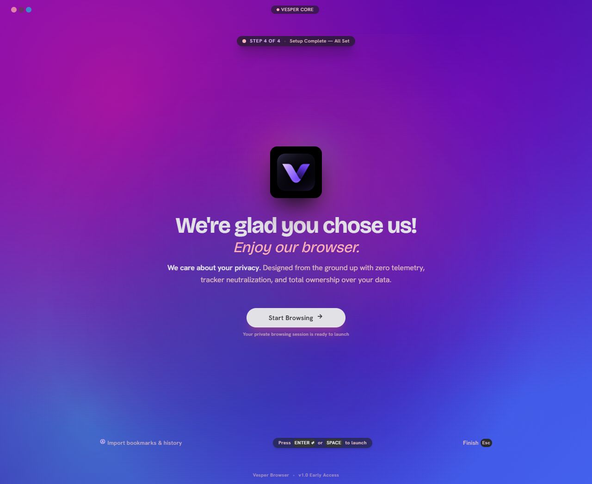
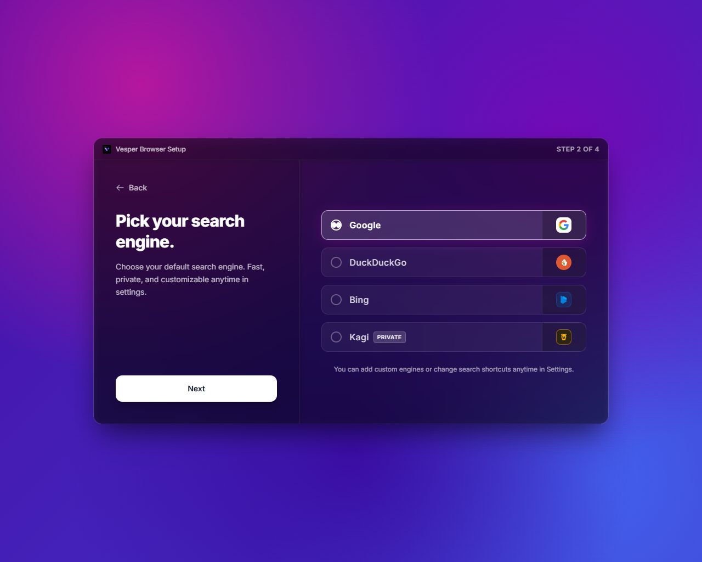
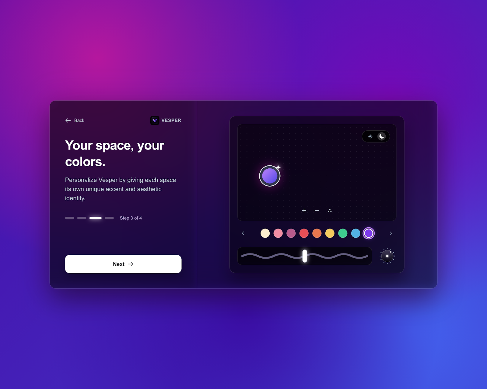
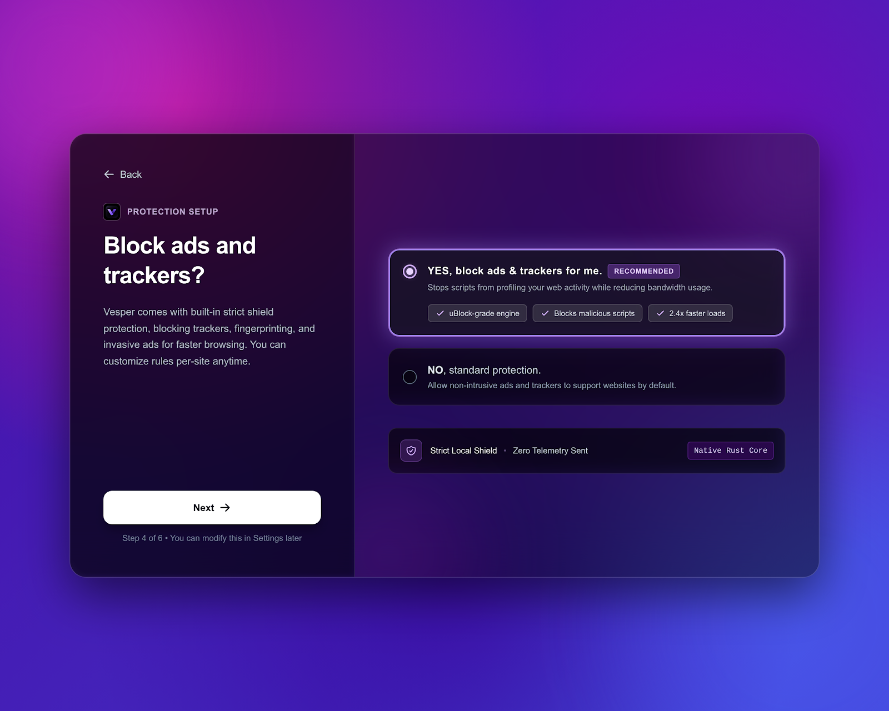
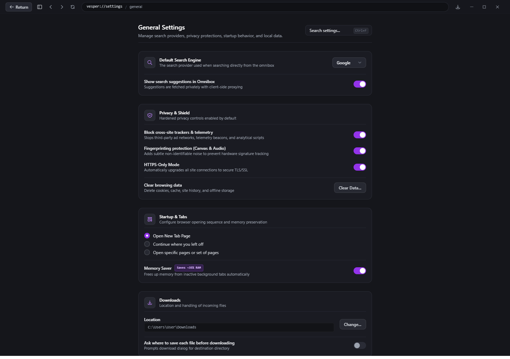
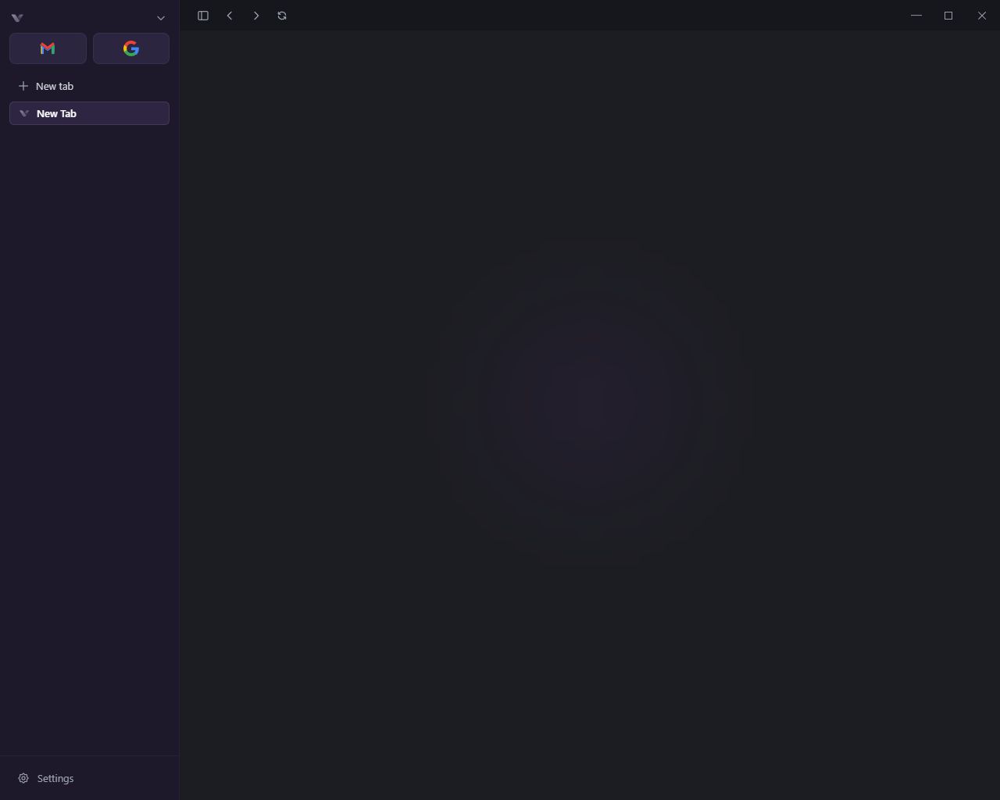

# Vesper Browser

[-8b5cf6?style=for-the-badge&logo=windows&logoColor=white)](https://github.com/Delta3211/vesper-browser/releases/latest/download/Vesper-Setup-0.2.0.exe)
[-3b82f6?style=for-the-badge&logo=windows&logoColor=white)](https://github.com/Delta3211/vesper-browser/releases/latest/download/Vesper.exe)
[](https://github.com/Delta3211/vesper-browser/releases/latest)

> 🚀 **Direct Download (No Terminal Needed!)**:
> - **[Click here to download Vesper Installer (Setup .exe)](https://github.com/Delta3211/vesper-browser/releases/latest/download/Vesper-Setup-0.2.0.exe)** — standard 1-click Windows installer (creates desktop & start menu shortcuts).
> - **[Click here to download Vesper Portable (.exe)](https://github.com/Delta3211/vesper-browser/releases/latest/download/Vesper.exe)** — standalone executable (run directly without installing).

---

A minimalist, privacy-focused browser interface built with React, TypeScript, and Tailwind CSS.

## 📸 Sneak Peek & Screenshots

Take a visual tour of Vesper before downloading:

### 1. Cinematic Onboarding & Interactive First-Run Setup
> The moment you launch Vesper, a 60fps Three.js cinematic setup guides you through configuring your search engine, theme preferences, and privacy shields.

<p align="center">
  
</p>

<p align="center">
  
  
</p>

### 2. Built-in Privacy Shield & Advanced Preferences
> Built with zero telemetry, local-first data storage, ad & tracker blocking, and a graphite settings console.

<p align="center">
  
  
</p>

### 3. Desktop Viewport & Workspaces
> Vertical tab workspaces, split-screen multi-tasking, and ambient obsidian purple accents.

<p align="center">
  
</p>

---

## Features

- **Modern UI**: Clean, dark graphite interface with purple accents
- **Keyboard-First**: Full keyboard navigation support
- **Privacy-Focused**: Zero telemetry, local-first architecture
- **Onboarding Flow**: Beautiful cinematic onboarding with Three.js backgrounds
- **Workspaces**: Organize tabs into separate workspaces
- **Split View**: Side-by-side tab viewing
- **Downloads Manager**: Track and manage downloads
- **Settings Modal**: Customizable browser settings

## Tech Stack

- **React 19** - UI framework
- **TypeScript** - Type safety
- **Vite 8** - Build tool
- **Tailwind CSS 4** - Styling
- **Zustand 5** - State management
- **Lucide React** - Icons
- **Three.js** - Cinematic onboarding backgrounds

## Getting Started

### Prerequisites

- Node.js 18+ 
- npm or yarn

### Installation

```bash
# Clone the repository
git clone https://github.com/Delta3211/vesper-browser.git
cd vesper-browser

# Install dependencies
npm install

# Start development server
npm run dev
```

The app will be available at `http://localhost:5173`

### Building for Production

```bash
npm run build
```

The built files will be in the `dist/` directory.

### Preview Production Build

```bash
npm run preview
```

## Project Structure

```
vesper-browser/
├── src/
│   ├── components/
│   │   ├── chrome/          # Browser chrome (omnibar, tabs, window frame)
│   │   ├── onboarding/      # Onboarding flow
│   │   ├── overlays/        # Modals (settings, downloads, etc.)
│   │   └── viewport/        # Tab content area
│   ├── lib/                 # Utilities and bridges
│   ├── store/               # Zustand state management
│   └── types/               # TypeScript type definitions
├── public/                  # Static assets
└── electron/               # Electron main process (desktop app)
```

## Usage

### Onboarding

On first launch, you'll be guided through:
1. Cinematic introduction
2. Search engine selection (DuckDuckGo, Google, Brave)
3. Data import from other browsers
4. Cloud sync setup (optional)
5. Ready to launch

### Keyboard Shortcuts

- `Ctrl+L` - Focus omnibar
- `Ctrl+T` - New tab
- `Ctrl+W` - Close tab
- `Ctrl+Tab` - Next tab
- `Ctrl+Shift+Tab` - Previous tab
- `Ctrl+\` - Toggle split view
- `Ctrl+,` - Open settings
- `Ctrl+J` - Open downloads
- `Ctrl+F` - Find in page
- `Escape` - Close modals/palettes

## Privacy

Vesper Browser is designed with privacy in mind:
- No telemetry or analytics
- Local-first data storage
- No external tracking
- Zero data sent to third parties

## Contributing

Contributions are welcome! Please feel free to submit a Pull Request.

## License

MIT License - see LICENSE file for details

## Roadmap

- [ ] Desktop app packaging (Electron)
- [ ] Auto-update mechanism
- [ ] Extension support
- [ ] More onboarding customization options
- [ ] Additional themes
- [ ] Performance optimizations

## Acknowledgments

Built with modern web technologies. Inspired by Arc, Brave, and other privacy-focused browsers.
